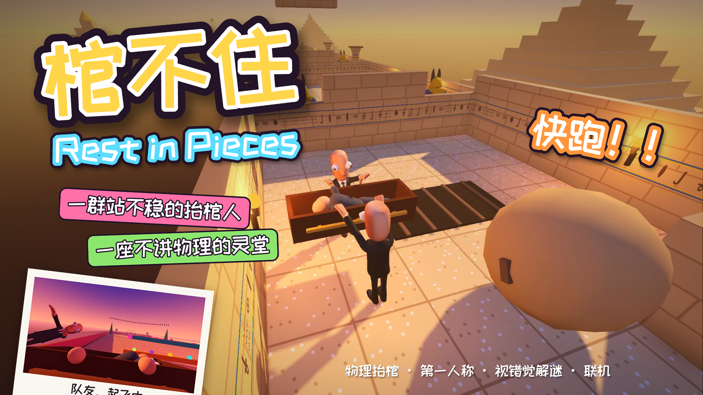

# 《棺不住 Rest in Pieces》作品说明

## 一句话介绍

一群站不稳的抬棺人，要把棺材抬过中国、埃及、墨西哥三座不讲物理的灵堂——会塌的地板、把人撞飞的机关、靠视错觉才接得上的断桥，逝者掉出来可就不体面了。

## 作品简介

《棺不住》是一款搞笑物理派对游戏。玩家扮演抬棺人，和队友一起抓住棺材的把手，把棺材穿过一个个房间、送上灵台。棺材靠真实物理抬着：两个人步调不一致就会歪，撞墙会颠，逝者是一个布娃娃，颠狠了就会从棺材里飞出去。路上还有地刺、推墙、滚石、火箭、刀摆和会塌的假地板，被撞中的人会松手飞出去。

游戏有三关、20 个房间：中国「殡仪馆的一天」、埃及「法老的最后一程」、墨西哥「万寿菊之路」。支持单人（电脑队友）、两人同屏和两台电脑联机。

## 使用方式

1. 解压试玩包，双击「棺不住.exe」（Windows 10 / 11，不用安装）。
2. 开始界面选模式：**2 两个人抬**（两人共用键盘、左右分屏，最推荐）、1 一个人抬（电脑队友）、3 / 4 建房间 / 加入房间（两台电脑联机，输入 4 位房间号）。
3. 选关、选房间（可以直接从任意房间开始）。
4. WASD 走，鼠标看路，**按住**鼠标左右键抓住棺材，一起把它抬到灵台。

完整操作和推荐试玩路线见《试玩文档》。

## 亮点

**1. 抬棺本身就好玩：物理协作的不确定性**
棺材、逝者、抬棺人全部是物理刚体。没有“自动跟随”，两个人得自己协调方向、速度和手的高度。一个人被撞飞，另一个人就得独自稳住一口歪掉的棺材。混乱是设计出来的，不是 bug。

**2. 第一人称的“现场感”**
默认第一人称：低头能看见自己的手抓在把手上，对面是队友那张呆滞的脸。被机关撞中时，镜头跟着身体一起在空中翻滚，落地后看着棺材躺在地上。

**3. 视角不对称的视错觉解谜：“信任之桥”**
中国关的断桥借鉴了纪念碑谷：切到俯视的人转动视角，让断开的桥“看起来接上了”，桥就真的接上了。但第一人称的人看到的永远是断桥，只能踩着只有自己看得见的金色虚线，相信队友走过去。一个人看到答案，另一个人负责执行，正是派对游戏里最好笑的那种沟通。
墨西哥关反过来：站到指定位置拿起相机拍一张照，远处断掉的路就会沿视线变成一段实的路。

**4. 三种葬礼文化，三套机关**
中国关有纸扎推墙、会自己弹开的冰柜、会躲开的灵台；埃及关有飞镖甬道、塌陷地板、滚石长廊、刀摆深渊；墨西哥关有多米诺墓碑桥、骷髅长臂、花船运河和烟花城堡。每个房间按“三段、一段比一段狠”的节奏设计，还有 I Wanna 式的坑：看着能走的地板会塌，花圈底下藏地刺。每关都有近路和藏在假墙后面的秘密。

**5. 不惩罚的计分：失误变成笑点**
派对游戏不设硬失败。体面值只按事件扣分（颠一下 -2、逝者掉出 -10、掉进深渊 -20），被撞飞不扣分。结算给评级、称号和奖章，比如「人在空中飞，棺在地上爬」「逝者想自己走」「空中飞人」，越狼狈的局越有东西可聊。

**6. 角色由 AHOLO Lux3D 生成**
抬棺人和逝者的模型由 AHOLO Lux3D 的文生 3D 生成，再用 Lux3D 的人形自动绑骨接入游戏的物理身体。我们固定了一套提示词模板（How to Fish 式的滑稽人物：光头、凸眼、没有脖子、瘦长身材），换角色时只改服装那一句，保证风格统一。

**7. 输入房间号就能联机**
房主的电脑计算全部物理，每秒 30 次把状态发给队友，队友这边插值显示，网络有抖动也看不出瞬移。我们在杭州的云服务器上部署了一个只转发数据包的中转程序，玩家输入 4 位房间号就能连上，不用装 VPN、不用查 IP。实测延迟约 44 ms，零丢包。

## 设计思路

**灵感**：网上流行的“抬棺舞”（Coffin Dance）是大家都知道的梗，葬礼本该庄重，抬棺人却在跳舞，这种反差本身就好笑。我们把它做成一个“想体面却总是不体面”的游戏：目标是庄重地送逝者最后一程，过程却是一路人仰马翻。

**参考**：《人类：一败涂地》的物理小人和协作、How to Fish 的滑稽人物画风、纪念碑谷的视错觉解谜、I Wanna 系列的“恶意”机关。

**核心循环**：抓稳 → 一起走 → 遇到机关（被撞飞、掉东西）→ 捡回来继续 → 送上灵台看结算。乐趣来自队友之间的不确定：解谜时常常需要有人放手，可少一个人抬，棺材就开始歪。

**关卡节奏**：早期试玩发现“一个房间只有一个机关”太短、没记忆点，后来改成每个房间三段、逐段加码，并加入近路和秘密，让熟练的玩家也有东西可找。

**技术方案**：Godot 4.7（GDScript）+ Jolt 物理，物理 120 Hz。联机采用房主权威：房主算物理，队友只发按键、显示插值快照。中转服务器用 Python 标准库实现，部署在杭州的 2 核 2G 云服务器上。

## 后续计划

- 4 人联机（目前联机和同屏都是 2 人，房主权威的架构可以直接扩展）
- 在大厅里上传照片，用 Lux3D 现场生成“自己”和“逝者”的模型
- 更多国家和葬礼文化的关卡
