# 《棺不住 Rest in Pieces》项目报告书

> 搞笑物理协作派对游戏 · Godot 4.7 + Jolt 物理 · AHOLO Lux3D 生成角色与道具
> 报告日期：2026-10-27　·　开发周期：2026-10-20 至今（19 次提交，约 6900 行 GDScript）

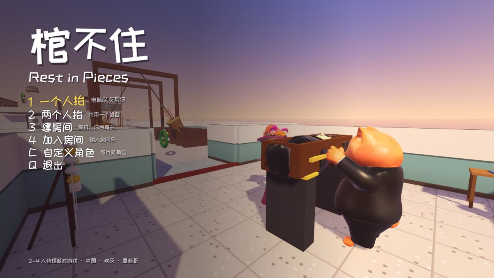

## 一、项目概述

一群站不稳的抬棺人，要把棺材抬过中国、埃及、墨西哥三座不讲物理的灵堂。棺材、抬棺人、逝者全部是物理刚体：两个人步调不一致棺材就歪，被机关撞中的人会松手飞出去，逝者颠狠了会从棺材里掉出来。

- **内容**：3 关 20 个房间，每个房间三段、逐段加码，含近路和假墙秘密
- **模式**：单人（电脑队友）、本地双人分屏、房间号联机（杭州中转服务器，实测约 44 ms）
- **Lux3D 接入**：默认抬棺人（文生 3D + 自动绑骨）、11 个主题道具；本次新增 **照片角色工作台**，玩家用自己的 API Key 把照片变成抬棺人或逝者

## 二、开发过程

| 日期 | 里程碑 |
| --- | --- |
| 10-20 | 抬棺物理原型 → 第一关白模 → 双人分屏 → 联机 → 「信任之桥」视错觉 → 第一关美术 |
| 10-21 | 关卡框架（Level 基类、计分、存档、选关）→ 埃及关 → 墨西哥关 → 按事件扣分 + 奖章 |
| 10-24 | 房间号联机（UDP 中转）→ 定名《棺不住》、标题页 → 宣传片工具链 → 提交材料 |
| 10-26～27 | 照片角色工作台、模型缓存、逝者骨架适配、联机模型同步；真实平台验收；本报告 |

以下截图都是把仓库切回当时的提交、用同一台机器重新运行截取的，不是事后重画。

**1. 抬棺原型（第 1 次提交）**：灰盒场景，只验证“两个人抓着一口物理棺材走”这件事好不好玩。

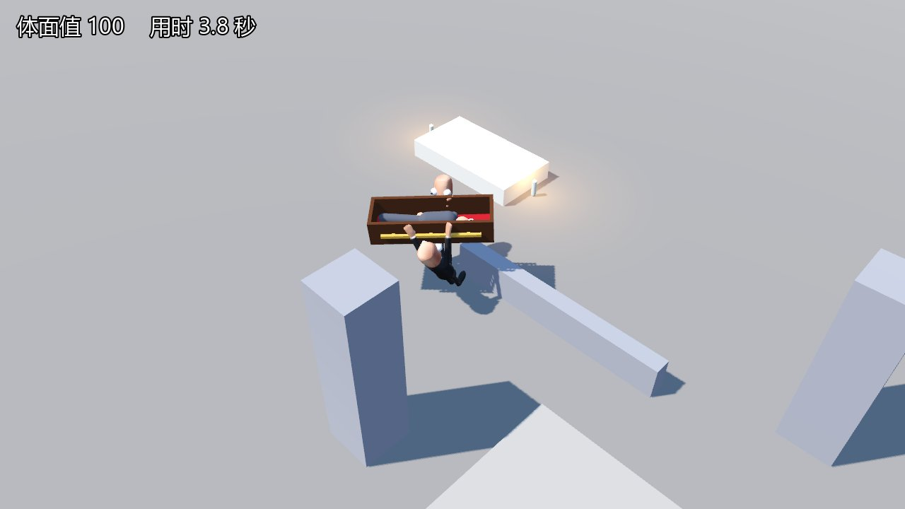

**2. 第一关白模（第 5 次提交）**：L 形走廊、花圈拾取、体面值。先用白模把玩法和节奏调顺。

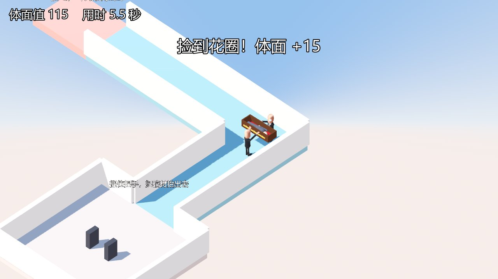

**3. 第一关美术（第 6 次提交）**：黄昏雾海、磨石地面、中式殡仪馆陈设，平涂卡通着色。

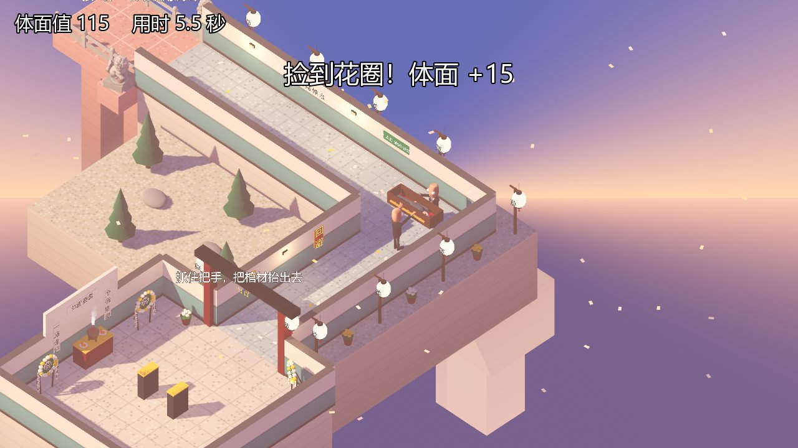

## 三、关键资产迭代对比

### 3.1 抬棺人模型（Lux3D 文生 3D）

**v1：矮胖 Q 版保镖。** 第一版提示词生成的结果。造型可爱，但头身比太 Q，第一人称看对面队友时脸会挡住大半个画面，和“滑稽、呆滞”的方向也不一致。

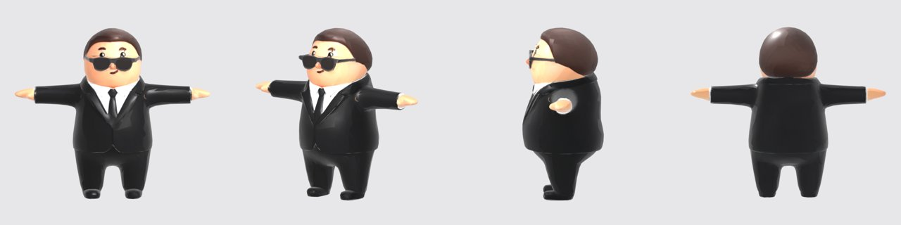

**v2：How to Fish 式滑稽人物。** 我们固定了提示词模板：光头、凸眼、没有脖子、瘦长身材、T 字姿势，换角色时只改服装那一句，保证风格统一。

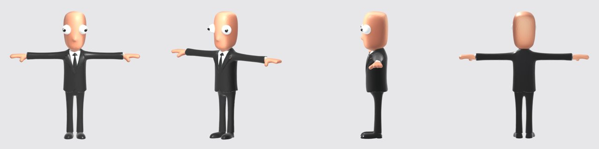

**v2 + Lux3D 自动绑骨（游戏内默认模型）。** 外观不变，带上 Mixamo 命名的人形骨架。游戏用胶囊刚体做身体、物理球做双手，再让手臂骨骼朝向双手位置。

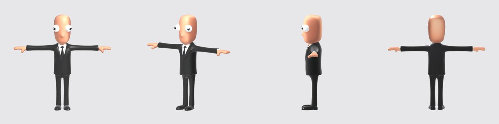

### 3.2 关卡场景

**埃及关（左：第一版 → 右：现在）**：第一版只是沙漠庭院加几个机关。试玩后发现“一个房间一个机关”太短、没有记忆点，于是重做成滚石长廊、刀摆深渊，墓室挪到最后。

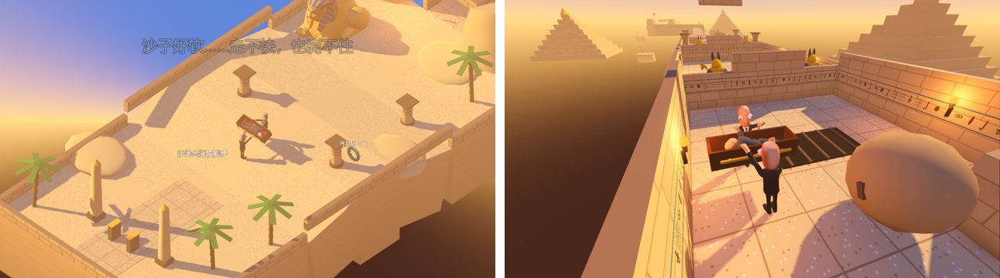

**墨西哥关（左：第一版 → 右：现在）**：从一张平铺的墓地大地图，改成集市、二楼回廊、花船运河和烟花城堡。

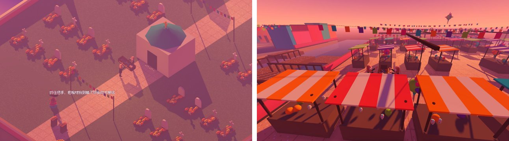

### 3.3 照片角色：输入照片的迭代

真实平台验收时，第一批两张输入图（左、中）都能顺利生成 3D 模型，但**自动绑骨被平台拒绝**，返回 `MODEL_NOT_RIGGABLE`：“双臂存在明显屈肘”和“双臂弯曲持握吉他”，不符合 T / A 字站姿。改成双臂水平张开的 T 字姿势（右）后，生成和绑骨都通过了。

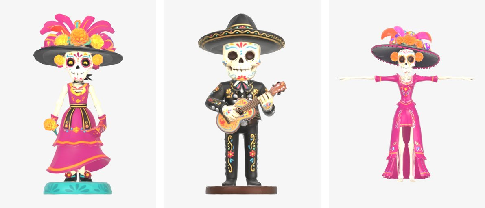

这次失败也暴露了一个游戏里的问题：原来游戏只提示“平台任务失败。”，不显示原因，玩家不知道该换姿势。现已改为显示平台给出的原因并附带建议，失败的任务记录也会自动清掉，可以直接换照片重新生成。

## 四、新功能：照片角色工作台

主菜单按 **C「自定义角色」**：选择应用到玩家一 / 玩家二 / 逝者 → 选一张 PNG / JPEG 全身照 → 填写自己的 AHOLO API Key → 点「生成并自动绑骨」。游戏直接调用官方接口完成上传、图生 3D、任务查询、人形自动绑骨和下载，不需要安装 SDK 或额外服务器。

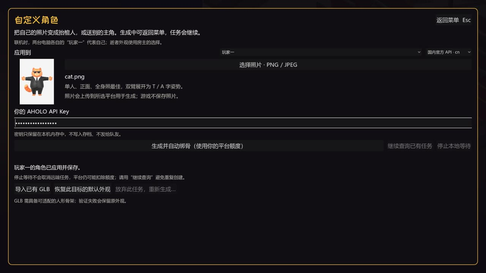

**本次真实验收用的三张输入图**（由 Lux3D 模型渲染的正面图，不是真人照片）：

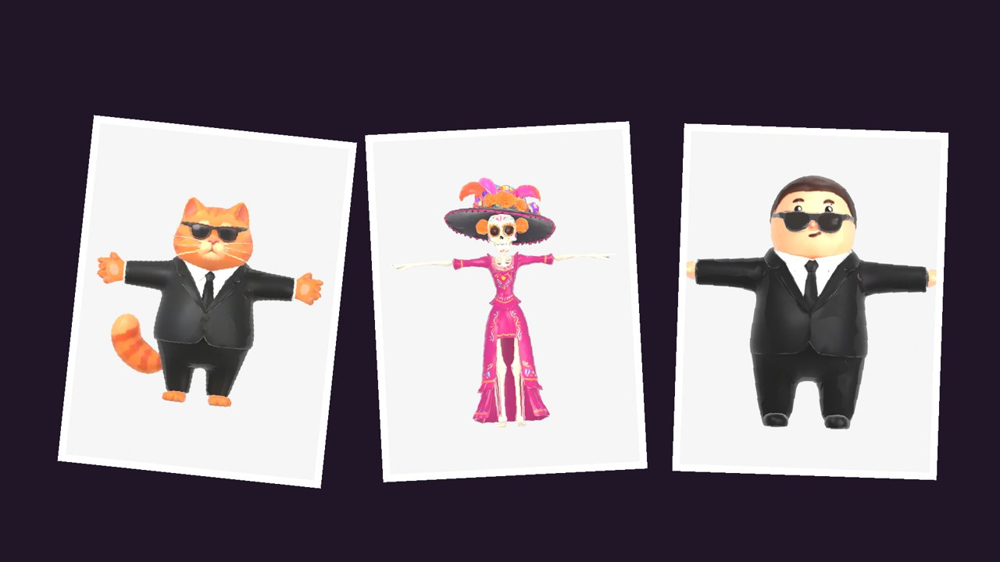

**平台返回的绑骨模型**（游戏校验通过、自动保存到本机缓存）：

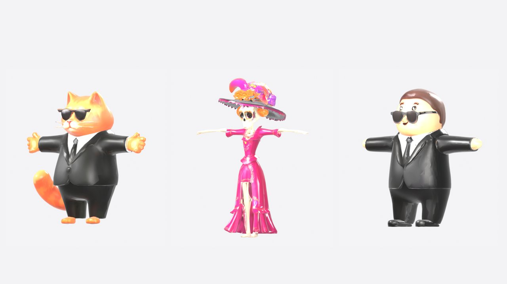

**进入游戏**：生成的模型只是外观，身体仍是原来的物理身体，所以站不稳、被撞飞也都和原来一样。第一人称看对面，抬棺的队友变成了卡特里娜：

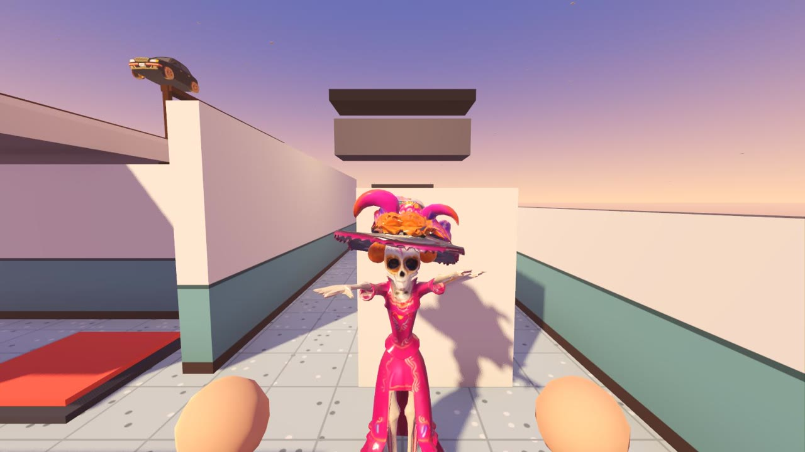

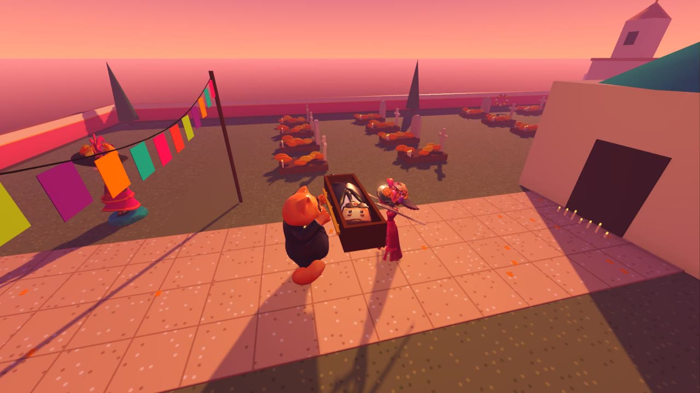

逝者换成保镖后，同样会被烟花撞出棺材：

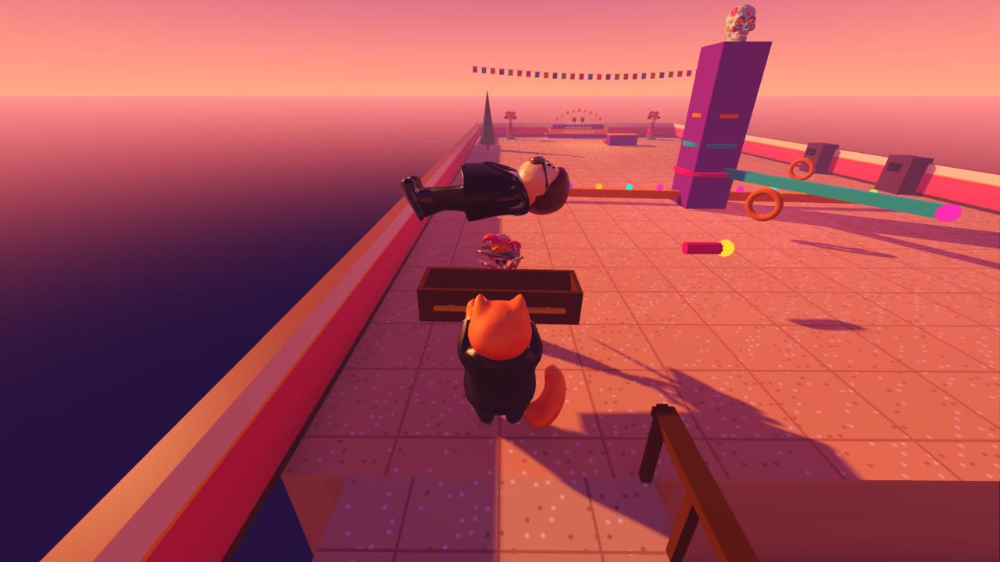

**设计要点**

- 密钥只在本机内存里，不写存档、不写日志、不发给联机队友；照片上传平台用于生成，游戏不缓存照片
- 任务号和阶段存盘：生成中可以返回菜单，网络中断后重新输入密钥即可「继续查询」，不会重复创建扣费任务
- 模型须为 ≤32 MiB、资源内嵌、带兼容人形骨架的 GLB；校验失败保留原外观
- 逝者保留原有 6 个刚体和关节，生成模型的骨骼跟随这些刚体运动；联机时只同步模型数据，物理快照结构不变

## 五、关键效果截图

**第一人称抬棺**：低头看见自己的手抓在把手上，对面是队友呆滞的脸。

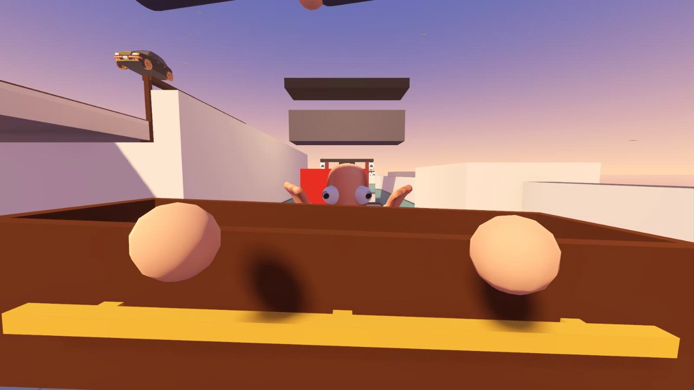

**被机关撞飞**：镜头跟着身体在空中翻滚，棺材还在地上。

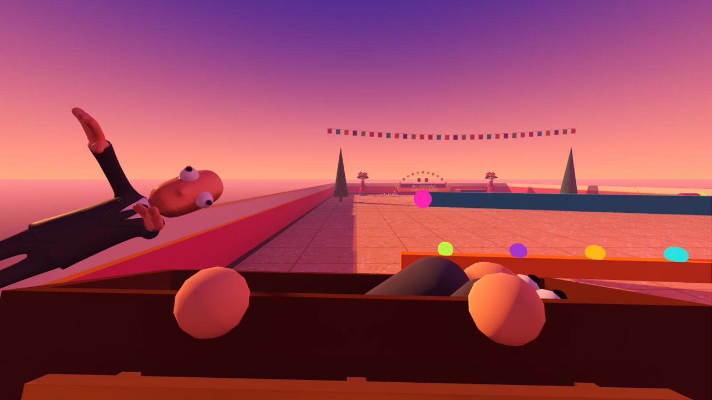

**信任之桥**：俯视的人转动视角让断桥“看起来接上”，桥就真的接上；第一人称的人只能踩着金色虚线相信队友。

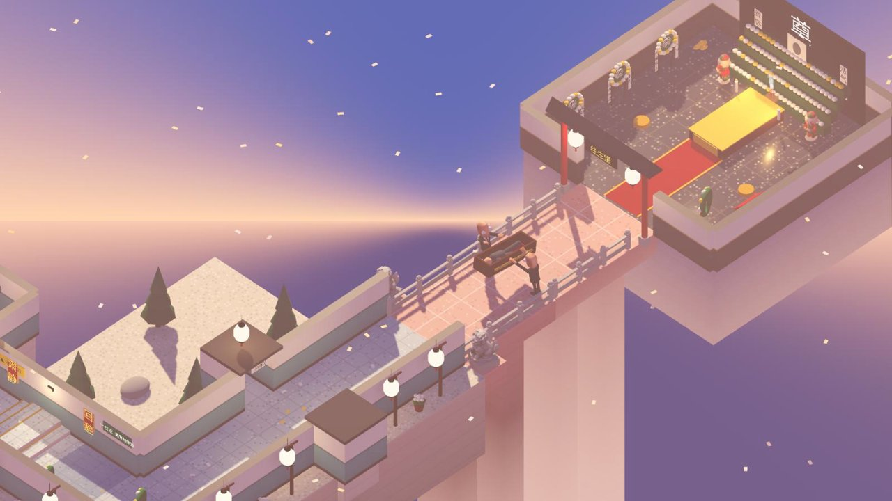

**拍照修路（左：拍照前 → 右：拍照后）**：在指定位置举相机拍照，远处那段路沿视线缩回断口，变成一段平涂灰色的“照片路面”。

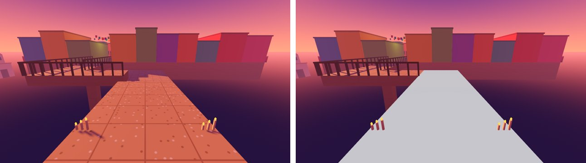

**结算**：按事件扣体面值，给评级、称号和奖章。

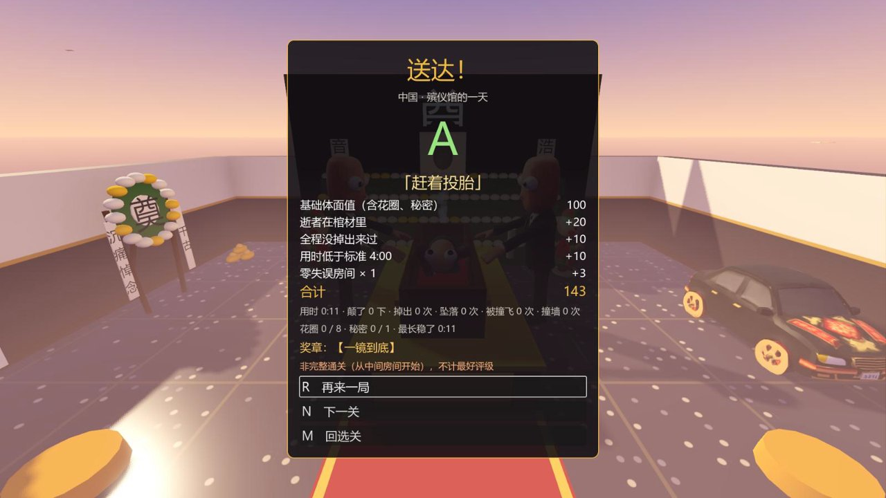

**标题页与主菜单**：新增 C「自定义角色」入口。

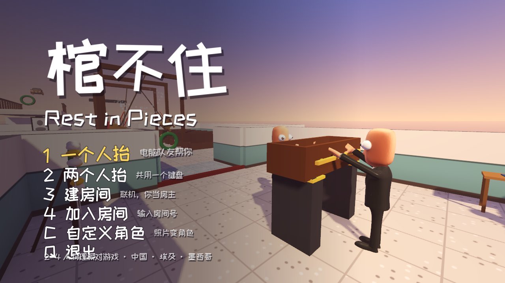

## 六、测试与验收

**离线自动测试（不消耗额度）**

| 测试 | 结果 |
| --- | --- |
| Python 工具与原生客户端（本地模拟 HTTP API：上传、生成、绑骨、下载、失败、取消、超时、恢复、平台拒绝原因） | 23 项通过 |
| Godot 模型缓存与外观适配（合法 / 损坏模型、刚体数量不变、渲染层、恢复默认） | 47 项检查，0 失败 |
| Godot 工作台（密钥遮蔽、任务恢复、防重复提交、取消、重置、平台最终失败后清除任务） | 通过 |
| Godot 联机模型同步（分块、校验、角色权限） | 18 项检查通过 |
| 整局回归：电脑队伍自动跑三关的多个房间、录制宣传片镜头 | 正常 |

**真实平台验收（2026-10-27，国内官方 API，使用游戏内同一套客户端代码）**

| 输入 | 生成任务 | 绑骨任务 | 结果 | 用时 |
| --- | --- | --- | --- | --- |
| 卡特里娜（屈肘） | 4416517 成功 | 4416731 | 平台拒绝：MODEL_NOT_RIGGABLE | 5.8 分钟 |
| 骷髅乐手（抱吉他） | 4416518 成功 | 4416738 | 平台拒绝：MODEL_NOT_RIGGABLE | 5.8 分钟 |
| 保镖（T 字） | 4417369 成功 | 4417729 成功 | 12.2 MB，游戏校验通过 | 6.7 分钟 |
| 卡特里娜（T 字） | 4417877 成功 | 4418084 成功 | 16.0 MB，游戏校验通过 | 9.1 分钟 |
| 直立橘猫（T 字） | 4418564 成功 | 4418728 成功 | 绑骨等待中途网络中断；用「继续查询」接上原任务，未重复创建，13.5 MB，校验通过 | 7.1 + 0.5 分钟 |

**已知问题（如实记录）**

宽檐帽 + 长裙的卡特里娜当**抬棺人**表现正常，但当**逝者**时会出现网格撕裂（下图）。原因是自动绑骨把帽檐、裙摆的部分顶点也绑到了手臂和腿的骨骼上；逝者躺下时手臂要折到身体两侧、双腿各自运动，这些顶点就被拉开。保镖和猫当逝者都正常。后续计划在逝者适配中对这类模型降低四肢的折叠幅度，或在导入时检测并提示。

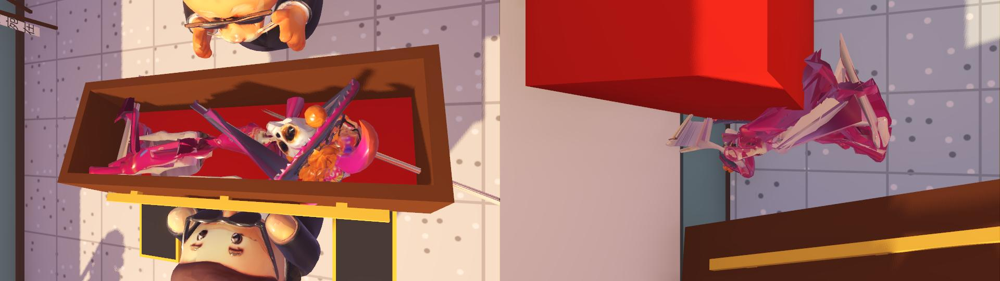

另外，平台的自动绑骨只接受类人形、T / A 字站姿的角色。四脚着地的真实宠物照片无法绑骨；本次的猫是让 Lux3D 先生成“直立、穿西装、T 字站姿”的拟人猫，再走照片流程。

## 七、后续计划

- 逝者适配改进（见已知问题），以及更细的肘、膝动作
- 4 人联机（房主权威架构可直接扩展）
- 更多国家和葬礼文化的关卡
