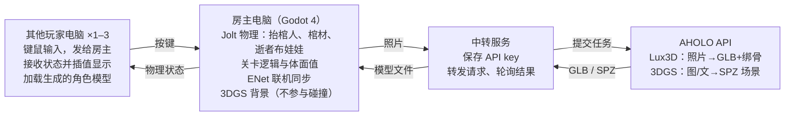

# 抬棺派对游戏 · 工作规划

2026-10-20 · 在线版：https://claude.ai/code/artifact/211d1851-87d9-4716-ba4a-dfba0aa21d86

> 本文件是在线文档的本地副本。两边内容有出入时，以在线版为准。

## 项目概述

一款 2–4 人联机的搞笑物理派对游戏：一群站不稳的抬棺人，要把一口棺材抬过一座不讲物理定律的灵堂，路上不能把里面的人颠出来。逝者和抬棺人都可以用玩家照片经 AHOLO Lux3D 现场生成，这就是我们使用他们产品的核心卖点。

**已拍板的决策**

| 项目 | 决定 |
| --- | --- |
| 基调 | 搞笑荒诞（结尾可留一点温情） |
| 引擎 | Godot 4.7.2 标准版（GDScript），已装在 `E:\Godot` |
| 平台与发布 | Windows 桌面 exe |
| 操作 | 只用键鼠，暂不做手柄 |
| 联机 | 每人一台电脑，局域网或在线联机；房主计算物理，其他人只发送按键 |
| 本地模式 | 单人模式（键鼠 + 电脑队友跟着抓、跟着走）优先；另有两人共用一个键盘的模式 |
| 镜头 | 固定视角和第一人称可切换（V）；固定视角可由一名玩家旋转（每次 45°），用于视错觉解谜；第一人称抓着棺材时可自由转头看路 |
| 角色来源 | Lux3D 用照片生成逝者和抬棺人，另备几个预设角色兜底 |
| 3DGS 用途 | 只做背景和氛围；玩法用的几何体是干净的低多边形 |
| 开发方式 | Claude 写几乎全部代码，团队负责试玩、提意见、准备素材 |

## 玩法设计

核心乐趣来自协作时的不确定：棺材至少要 2 人才抬得稳，可解谜时又得有人放手去转机关。

**一局游戏的流程**

1. 大厅：创建或加入房间，每人上传自己的照片，房主上传“逝者”照片；后台异步生成模型，等待期间可以先抬空棺练习
2. 抬棺：每人抓住棺材一个把手，一起移动
3. 解谜房：有人放手去转机关，其余人稳住棺材
4. 送达：把棺材放上灵台，按体面值和用时结算，回放最狼狈的瞬间

**体面值**（满分 100）

- 棺材倾斜超过一定角度、撞墙、撞地：持续或单次扣分
- 逝者被颠出棺材：大扣分，要有人把他捡回来塞进去才能继续
- 体面值归零不算失败，只是结算评级很难看（派对游戏不设硬失败）
- 棺材或逝者掉在地上时，往下看就会弯腰去够，可以捡起来

**角色**

- 抬棺人：半布娃娃的物理小人（人类一败涂地风格），外观取自玩家照片或预设
- 逝者：纯布娃娃，会在棺材里乱晃、被甩出去
- 画风（已定稿）：How to Fish 式滑稽人物，光头、没有脖子、凸眼、瘦长，低多边形平涂。标准模型和提示词模板见 `docs/角色风格.md`

**操作（键鼠）**

| 按键 | 联机模式 | 本地双人模式 P1 / P2 |
| --- | --- | --- |
| 移动 | WASD | WASD / 方向键 |
| 左手抓握 | 鼠标左键（按住） | Q / 小键盘 1 |
| 右手抓握 | 鼠标右键（按住） | E / 小键盘 3 |
| 举手高度 | 鼠标上下移动 | 无（固定高度） |
| 跳 | 空格 | 左 Shift / 小键盘 0 |
| 交互（转机关） | F | R / 小键盘 Enter |

## 关卡与解谜

解谜考的是配合，不考操作精度：视错觉路径一旦接上就做得足够宽，布娃娃也能晃过去。每个房间一个固定镜头，纪念碑谷式的错觉本来就靠固定视角成立。

| 房间 | 内容 | 教什么 / 笑点 |
| --- | --- | --- |
| 1 殡仪馆后门走廊 | 直走廊加几个转角、一段台阶 | 教抬棺、转弯、上台阶；逝者第一次被颠出来 |
| 2 旋转灵堂 | 一人放手去转大转盘，断开的桥在视觉上接上，其余人抬棺过桥 | 核心视错觉机制；少一个人抬，棺材开始倾斜 |
| 3 无尽楼梯 | 彭罗斯阶梯：绕一圈又回到原处，得按特定顺序踩机关才能走出去 | 阈限空间的迷失感；被困住的无助感 |
| 4 终点灵堂 | 背景是用逝者照片生成的 3DGS 场景，把棺材放上灵台 | 结算和回放；一点荒诞的温情 |

**过渡空间**：房间之间的走廊、窗外景色用预生成的 3DGS 阈限空间（空无一人的商场、泳池、办公室）。它们只作视觉展示，不参与碰撞。

超出 MVP 的备选机关：透视接桥（近大远小）、重力翻转房、抬棺舞节奏段（踩拍加分）。

## 技术架构

房主的电脑计算全部物理，其他玩家只发按键、收状态；API key 只留在中转服务上，游戏本体里没有 key。

- **引擎**：Godot 4.7.2 + 内置 Jolt 物理；角色是用关节连起来的刚体，抓握就是在手和把手之间临时加一个关节
- **联机**：Godot 自带的 ENet 高层联机 API，房主权威；客户端对收到的位置做插值，避免瞬移
- **运行时加载模型**：用 Godot 自带的 GLTFDocument 在游戏里直接读入 Lux3D 的 GLB，由房主下载后分发给其他玩家
- **3DGS**：先试 Godot 社区的高斯泼溅插件；不行就预渲染成全景图
- **中转服务**：一个小的 HTTP 服务（免费云函数即可），只开放“提交生成”和“查询结果”两个接口；如果只在本机演示，就换成房主电脑上的本地脚本读 `.env`

## 阶段计划与 MVP

先把抬棺手感做好玩，再加联机和关卡，最后接入 AHOLO 的现场生成。各阶段按顺序推进，只有第 0 阶段可以和第 1 阶段同时进行。每个阶段要先过团队试玩这一关，才进入下一阶段。

| 阶段 | 做什么 | 过关标准 |
| --- | --- | --- |
| 0 资产验证 | Lux3D 生成 2–3 个人并绑骨；3DGS 场景在 Godot 里显示 | 生成的人能放进 Godot |
| **1 抬棺原型** | 物理小人、棺材、布娃娃逝者；本地双人键盘模式 | **团队试玩觉得好笑** |
| 2 联机 | 房主权威同步、客户端插值；大厅：建房、加入 | 两台电脑一起抬不抖 |
| 3 关卡 | 4 个房间、旋转转盘机关；体面值与结算 | 完整通关一次 |
| 4 AHOLO 整合 | 大厅上传照片，生成角色；中转服务、3DGS 背景 | 现场拍的照片能进游戏 |
| 5 打磨与打包 | 音乐音效、界面、狼狈回放；导出 exe、路演彩排 | 在干净的电脑上能跑 |

第 1 阶段是整个游戏的命脉：如果抬棺本身不好笑，后面的内容都救不回来。

**MVP 清单**（做完这些就能参赛）

- [ ] 2 人联机抬棺，体面值与逝者会被颠出来
- [ ] 3 个房间：教学走廊、旋转灵堂、终点灵堂
- [ ] 用照片生成逝者，并有 3 个预设角色兜底
- [ ] 至少 1 个 3DGS 场景用作背景
- [ ] 本地双人键盘模式
- [ ] 可双击运行的 exe

**有余力再做**：3–4 人、抬棺人也用照片生成、无尽楼梯房、抬棺舞节奏段、现场生成 3DGS 场景。

## 分工

Claude 负责写代码和调 API，团队负责判断好不好玩、准备素材和路演。每个阶段结束都由团队试玩验收。

| 谁 | 负责 |
| --- | --- |
| Claude | 全部 GDScript 代码与场景搭建；物理与联机；AHOLO API 接入与中转服务；打包 exe |
| 团队（试玩） | 每个原型都要实际玩一遍，反馈“好不好笑、难度对不对”；联机测试要准备 2–4 台电脑 |
| 团队（素材） | 提供角色照片、选 3DGS 场景的描述或参考图、找免版税音乐和音效 |
| 团队（路演） | 游戏名、世界观一句话、演示脚本、录屏 |

- [ ] 团队：给出 2–3 张正面全身人物照，放到 `E:\tomb`
- [ ] 团队：确认联机测试用的电脑是否在同一局域网

## 风险与待定事项

风险最大的是联机物理同步，其次是抬棺手感，所以这两项都放在最前面验证。

| 风险 | 影响 | 兜底方案 |
| --- | --- | --- |
| 联机时物理不同步、抖动 | 客户端看到棺材瞬移 | 只由房主计算物理，客户端做插值平滑；实在不行就把本地双人模式作为演示主力 |
| 抬棺手感不好玩 | 核心乐趣没了 | 第一阶段只做这一件事，反复调参数 |
| Lux3D 绑骨结构不统一 | 生成的人套不到物理角色上 | 用标准骨骼重定向；不行就只用生成模型的外观，挂在简单的胶囊身体上 |
| 生成太慢 | 大厅等太久 | 等待时可以抬空棺练习；提前生成的预设角色随时可用 |
| Godot 里显示 3DGS 不成熟 | 背景做不出来 | 先试社区插件；不行就把 3DGS 预先渲染成 360° 全景图做天空盒 |
| 密钥外泄 | API 额度被盗用 | key 只放在 `.env` 或中转服务器，不提交到 git、不打进 exe；比赛结束后重新生成 |
| 音乐版权 | 抬棺舞原曲 *Astronomia* 不能用 | 免版税铜管乐或 AI 生成的原创曲 |

**待定事项**

- [ ] key 方案：用中转服务器（可以分发给别人玩），还是只在本机演示？
- [ ] 游戏名：《抬走不送》《入土为安？》或者自己起
- [ ] 黑客松交付形式：现场演示、录视频，还是提交安装包？截止日期？
- [ ] 在线联机是否需要跨局域网（这样需要中继服务或 Steam），还是只要局域网？
